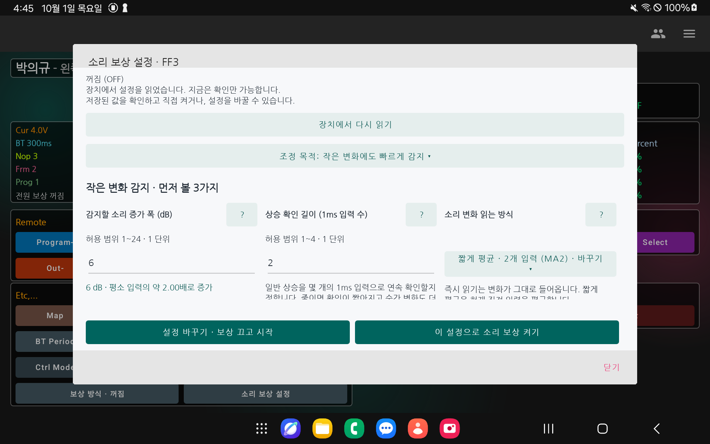
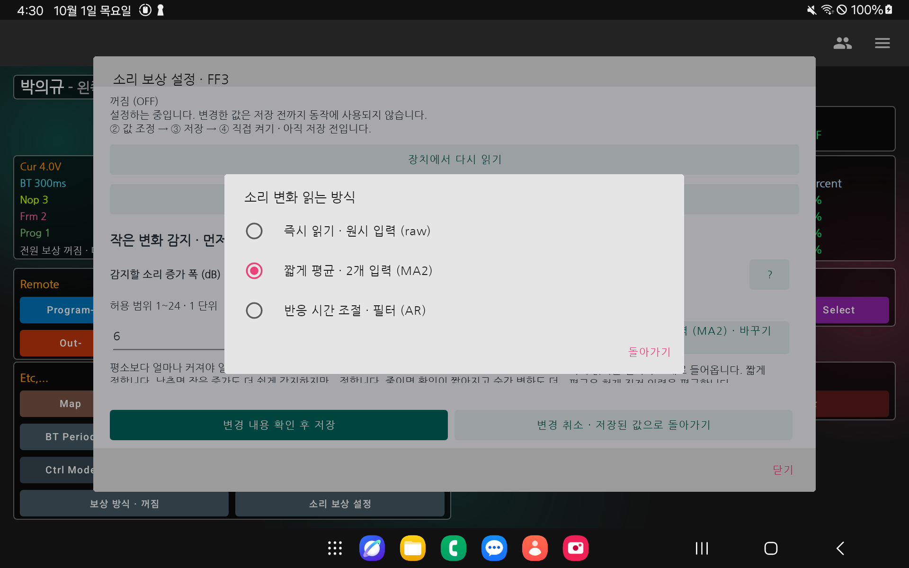
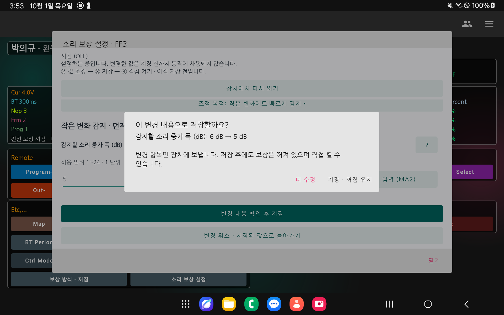

# FF3 사용과 제어 방법

## 1. 무엇을 하는 기능인가

**FF3는 마이크 소리가 더 큰 구간으로 올라갈 때 전원 설정을 미리 높이는 기능이다.** 감지할 소리 변화와 추가할 전원 보상량을 각각 정한다. 더 민감하게 감지하고 싶다고 보상 한도부터 높일 필요는 없다.

앱에서는 `소리 보상 설정`을 열고 원하는 **조정 목적**을 선택한다. 현재값 확인 → 보상을 끄고 값 조정 → 변경 내용 확인 후 저장 → 직접 켜기 순서다. 저장만으로 보상이 켜지지 않는다.

이 안내는 2026-10-01 UI 개편본, 프로토콜4.6/schema3 장치 기준이다. 처음 연결하면 장치의 기존 설정을 읽는다. 앱이 권장값을 넣거나 연결만으로 설정을 바꾸지는 않는다. 실제 시험 장치 `TD_L_PEK_FFFF`의 설정은 보상 한도11, 소리 구간6개, 짧게 평균(MA2)이었다.

## 2. 작은 변화에도 빠르게 반응하게 하고 싶다

메인 화면의 **소리 보상 설정 → 조정 목적: 작은 변화에도 빠르게 감지**를 선택한다. 이 목적은 첫 화면에 기본으로 표시된다.

먼저 아래 세 항목을 본다. 한 항목씩 바꾸면 무엇 때문에 동작이 달라졌는지 비교하기 쉽다.

| 원하는 변화 | 화면에서 볼 항목 | 값을 바꾸면 무엇이 달라지는가 |
|---|---|---|
| 더 작은 소리 증가도 잡기 | **감지할 소리 증가 폭** | 낮추면 평소 대비 더 작은 증가도 일반 상승으로 볼 수 있다. 잔변동에도 반응할 수 있다 |
| 일반 상승을 더 짧게 확인하기 | **상승 확인 길이** | 줄이면 연속 확인하는 1ms 입력 수가 줄어든다. 순간 변화도 더 쉽게 통과할 수 있다 |
| 입력을 덜 평균해서 읽기 | **소리 변화 읽는 방식** | `즉시 읽기`는 원시 입력, `짧게 평균`은 현재·직전 입력 평균, `반응 시간 조절`은 어택/릴리즈 평활 |

현재값6dB는 **평소 입력 크기의 약2배**가 된 일반 상승을 판단하는 기준이다. 화면은 dB 입력칸 아래에 배수를 함께 표시하고, 숫자를 바꾸면 배수도 갱신한다. 확인 길이2는 1ms 입력2개를 연속 확인한다는 뜻이다. 모든 소리가 고정2ms 뒤에 보상된다는 뜻은 아니다. 가장 작은 구간을 벗어나거나 급격히 커진 소리는 첫 입력을 우선할 수 있다.

### dB를 입력 크기 배수로 읽기

여기서 배수는 **입력의 진폭비**다. 전력이나 사람이 느끼는 소리 크기의 배수를 뜻하지 않는다. 진폭비는 `10^(dB 변화/20)`으로 계산하며, 화면은 설명용 근사값을 소수 둘째 자리까지 표시한다. 장치에는 기존 dB 정수를 보내고 실제 비교는 펌웨어의 정수 비율표를 사용한다. [음압과 dB의 관계](https://www.osha.gov/otm/section-3-health-hazards/chapter-5).

| dB 변화 폭 | 커질 때 입력 크기 | 작아질 때 입력 크기 |
|---:|---:|---:|
| 1dB | 약1.12배 | 약0.89배 |
| 3dB | 약1.41배 | 약0.71배 |
| 5dB | 약1.78배 | 약0.56배 |
| 6dB | 약2.00배 | 약0.50배 |
| 12dB | 약3.98배 | 약0.25배 |
| 20dB | 10배 | 0.10배 |

예를 들어 평소 입력이100이면 감지 증가 폭6dB는 약200,3dB는 약141을 기준으로 이해할 수 있다. 새 기준으로 삼을 감소 폭6dB는 최고 입력100에서 약50으로 작아진 경우다. 실제 입력은 필터·정수 반올림·구간 조건도 함께 적용된다.

- **감지 증가 폭 / 급격한 증가 기준 / 최고값 갱신 폭**: 각 비교 기준보다 몇 배 커졌는지 표시한다.
- **새 기준으로 삼을 감소 폭**: 최고 입력의 몇 배로 작아졌는지 표시한다.6dB 감소는2배가 아닌0.5배다.
- **작은 소리의 안정 허용 폭**: 관찰한 큰 입력과 작은 입력의 비율이다.3dB는 약1.41배 미만,0dB는 변화 없음이다.
- **구간 내려갈 때의 여유 폭**: 상승 경계 음압의 몇 배인지 표시한다.1dB 낮은 경계는 약0.89배다.

구간 표의 **dBSPL은 절대 경계값**이다.46dBSPL 자체를46dB 증가로 읽으면 안 된다. 구간2가40dBSPL, 구간3이46dBSPL이면 두 경계의 차이는6dB이고 **구간3 경계 음압은 구간2의 약2배**다. 앱은 직전 경계와 비교한 음압비를 표시한다. 첫 하단 구간의0은 특별값이므로 배수를 계산하지 않으며, 마이크 원시값의 경계는 장치 보정표를 따른다.

읽는 방식의 `바꾸기 ▾` → 설정 시작 안내 확인 → 원하는 방식 선택 → `변경 내용 확인 후 저장` 순서로 바꾼다. **OFF로만 바꾼 것과 설정 편집을 시작한 것은 서로 다른 단계다.** 처리 중에는 선택 버튼이 잠기며, 준비가 끝나면 다음 선택 창이 열린다.

`급격한 변화·평소 소리 기준 설정 펼치기`에서 다음을 추가로 조정한다.

| 항목 | 언제 보는가 |
|---|---|
| 급격한 소리 증가 기준 | 갑자기 큰 변화의 첫 입력을 우선하는 조건을 바꾸려 할 때. 감지할 소리 증가 폭 이상이어야 한다 |
| 필터의 상승 반응 시간 | 읽는 방식이 `반응 시간 조절(AR)`일 때. 줄이면 상승을 더 빨리 따라가고0은 즉시 반응. 다른 방식에서는 수정할 수 없다 |
| 평소 소리 추적 시간 | 변화 판단의 기준이 소리를 따라가는 속도를 바꿀 때. 짧게 해도 보상이 항상 빨라지지는 않는다 |
| 시작 시 소리 기준 준비 시간 | 시작 직후 평소 소리 기준을 준비하는 시간. 매 소리의 지연 시간이 아니다 |
| 같은 구간의 최고값 갱신 폭 | 같은 최고 구간 안에서 최고값 기록을 갱신할 조건. 더 높은 구간의 요청을 막는 기준이 아니다 |

**감지 기준을 낮춰도 전원 보상이 항상 추가되는 것은 아니다.** 더 높은 소리 구간 진입, 남은 전원 보상량, 전원 상한과 실행 조건도 영향을 준다. `소리 크기별 전원 보상량` 목적에서 소리 구간 경계와 추가량도 확인한다. 앱 설명은 조정 방향을 알려 주며 검증된 추천 수치를 뜻하지 않는다.

## 3. 실제로 값을 바꾸고 저장하는 순서

1. 대상 장치와 `REL4.6`을 확인하고 자동 읽기가 끝날 때까지 기다린다.
2. `소리 보상 설정`을 연다. 처음에는 현재값을 보여 주며 숫자 입력칸은 잠겨 있다. **읽는 방식은 MA2로 고정된 것이 아니다.** `짧게 평균 · 2개 입력 (MA2) · 바꾸기 ▾`를 누르면 설정 시작 안내가 열린다.
3. 안내에서 `보상 끄고 설정 시작`을 누른다. 이미 OFF이면 `설정 시작 · 꺼짐 유지`로 표시된다. 보상이 OFF로 저장되고 장치 편집을 시작한다. 읽는 방식 버튼으로 진입했다면 준비가 끝난 뒤 `즉시 읽기(raw)` / `짧게 평균(MA2)` / `반응 시간 조절(AR)` 선택 창이 바로 열린다. 숫자부터 바꾸려면 하단 `설정 바꾸기 · 보상 끄고 시작`으로 시작해도 된다.
4. 원하는 목적에서 필요한 항목만 바꾼다. 입력한 값은 아직 동작에 사용되지 않는다. 다른 목적으로 이동해도 입력은 유지된다. 항목 옆 `?`에서 뜻과 기술명을 확인한다.
5. 화면 아래 고정된 `변경 내용 확인 후 저장`을 누른다. 제약에 맞지 않으면 이유가 표시되고 관련 설정 화면으로 이동한다.
6. **바뀐 항목과 전후값**을 확인하고 `저장 · 꺼짐 유지`를 누른다. 앱이 변경 항목 전송, 장치 검사/저장, 전체 되읽기와 파일·입력 처리부 확인을 수행한다.
7. `설정 저장됨 · 보상은 꺼져 있습니다`를 확인한다. 같은 창에서 `이 설정으로 소리 보상 켜기` → `FF3 켜기`를 선택한다.
8. 메인에 `소리 보상 켜짐 · FF3`가 표시되는지 확인하고 `보상 동작 확인`에서 두 시점의 성공 횟수를 비교한다.

보상 켜기와 실제 실행은 다르다. 내부기 연결, Normal/Live, 양수 음량, CIS/nOFm 전략, 프레임1~9, 링크 제어모드0, 강제 고정/무한 재시도 없음 등의 조건도 필요하다. 메인 `Mode ISD`는 링크 제어 방식이고 FF 모드 번호가 아니다. 실행 조건은 `보상 방식` 선택 창에서도 확인한다.

## 4. 전원 보상량을 바꾸고 싶다

조정 목적을 **소리 크기별 전원 보상량**으로 바꾼다. 이것은 감지 민감도를 정하는 첫 목적과 별개다.

| 항목/열 | 뜻 |
|---|---|
| 남아 있는 전원 보상 한도 | 아직 회수되지 않은 전원 보상의 최대량. 기술명은 G |
| 사용할 소리 구간 수 | 앞에서부터 사용할 구간 수. 2~16개 |
| 시작 dBSPL | 이 소리 크기부터 해당 구간에 진입. 첫 구간의0은 가장 작은 소리 전체를 뜻함 |
| 추가 스텝 | 바로 아래 구간에서 올라올 때 요구에 더할 보상량 |
| 소리 묶기 ms | 마지막 높은 입력 뒤 같은 소리 사건을 묶는 시간. 시간이 끝나면 무조건 전압을 내리는 타이머가 아님 |

1스텝은 전원 설정25mV 변화다. 실제 rail 전압을 측정한 값이 아니다. 구간별 추가량의 누적 차이, 남은 보상, 보상 한도와 전원 상한으로 실제 추가량이 제한된다. 한도만 높였다고 입력 감지가 민감해지지 않는다.

현재 시험 장치 표는 다음과 같았다. 앱은 현재 구간 수만 먼저 보여 주고 나머지는 `사용하지 않는 구간 표시 / 숨기기`로 볼 수 있다.

| 구간 | 시작 dBSPL | 추가 스텝 | 앞에서부터 누적 스텝 | 소리 묶기 ms |
|---:|---:|---:|---:|---:|
| 1 | 0, 하단 전체 | 0 | 0 | 40 |
| 2 | 40 | 4 | 4 | 40 |
| 3 | 46 | 3 | 7 | 40 |
| 4 | 55 | 2 | 9 | 50 |
| 5 | 65 | 1 | 10 | 60 |
| 6 | 80 | 1 | 11 | 80 |
| 7~16 | 0 | 0 | 11 유지 | 0 |

예를 들어 구간1을 기준으로 구간3에 올라가면 요구는4+3=7스텝이다. 구간3을 새 기준으로 잡고 구간5로 올라가면 누적 차이10−7=3스텝이다. 실제 전원 추가량은 이 요구보다 작을 수 있다.

설정 순서는 **사용 구간 수 → 시작 크기 → 추가량 → 보상 한도 → 같은 소리로 묶는 시간**이다. 화면의 합계/한도 설명으로 관계를 확인한다.

- 첫 구간의 시작/추가량은0으로 고정된다. 나머지 시작 크기는29~110dBSPL 오름차순이다. `구간 내려갈 때의 여유 폭`을 뺀 값도29 이상이어야 한다.
- 추가량은0~40이다. 구간3 이후는 바로 아래 구간의 추가량보다 커질 수 없다.
- 추가량 합계는0보다 크고 보상 한도 이하여야 한다. 한도는 최대40이다.
- 사용하는 행의 소리 묶기 시간는10~2550ms,10ms 단위다. 미사용 행은 세 값 모두0이다.
- 사용 구간 수를 줄여도 나머지 값이 자동으로 삭제되지 않는다. 미사용 행을 펼쳐 직접0으로 맞춘다.

## 5. 다음 소리를 다시 감지할 조건을 바꾸고 싶다

조정 목적을 **다시 감지할 조건·처리 시간**으로 선택한다. 소리가 충분히 작고 안정됐다는 근거를 확인해 더 작은 소리를 새 기준으로 삼는 설정이다. 큰 소리가 계속 유지되면 시간만 지났다고 반복해서 새 보상을 주지 않는다.

| 화면 항목 | 무엇을 판단하며 값을 바꾸면 어떻게 달라지는가 |
|---|---|
| 작아진 소리를 따라가는 완만함 | 작아진 입력을 얼마나 부드럽게 따라갈지 정함. 큰 값은 느리게 수렴. 시간ms가 아님 |
| 새 기준으로 삼을 소리 감소 폭 | 작은 소리 후보로 삼을 감소 기준. 낮추면 작은 감소도 후보가 될 수 있음 |
| 작은 소리 확인 시간 | 작아진 소리가 연속 유지돼야 하는 시간. 줄이면 확인이 짧아지지만 다른 조건도 필요 |
| 작은 소리의 안정 허용 폭 | 후보 소리의 흔들림을 허용하는 폭. 큰 값은 더 큰 변동 허용 |
| 구간 내려갈 때의 여유 폭 | 상승 경계보다 낮게 잡아 구간 왕복을 줄이는 폭 |
| 전원 여유 확인 사용 | 최저 구간 밖의 작은 소리를 새 기준으로 확정할 때 신선한 전원 여유 확인이 필요한지 선택 |
| 전원 여유 확인의 유효 시간 | 얼마나 오래된 여유 확인까지 사용할지 정함.100ms 단위 |
| 보상 요청 유효 시간 | 만들어진 보상 요청을 유효하게 두는 시간. 전원 조정 최소 간격보다 길어야 함 |
| 전원 조정 최소 간격 | 전원 쓰기 사이의 최소 간격. BLE 앱 요청 간격과 다름 |
| 입력 끊김 판단 시간 | 입력 갱신이 너무 오래 끊겼는지 판단 |
| 마이크 보정표 | 원시 마이크값과 소리 크기 경계를 연결. 현재는1번만 지원하므로 읽기 전용 |

전원 여유 확인은 Normal 백텔 피드백의 High를 뜻한다. 작은 소리 확인 시간, 소리 묶기 시간, 평활 수렴과 High 근거가 함께 작용한다. Low/NoBacktel은 High 근거를 취소할 수 있다. 시간 하나만 보고 그 간격마다 다시 보상이 된다고 해석하지 않는다.

## 6. 저장하지 않은 변경과 연결 오류

| 상황 | 할 일 |
|---|---|
| 변경을 모두 취소하고 싶음 | `변경 취소 · 저장된 값으로 돌아가기` 선택. 마지막 저장값을 읽고 보상은 꺼짐 유지 |
| 입력 중 다른 목적을 보고 싶음 | 목적만 선택. 화면 입력은 유지됨 |
| 입력 중 다시 읽기/닫기 | 변경 입력이 있으면 버릴지 묻는다. 화면 입력은 저장하지 않으면 사라짐 |
| 창을 닫고 다시 연결함 | 장치 편집은 남을 수 있음. `남아 있는 설정 이어서 바꾸기` 또는 변경 취소 선택 |
| 통신 중 닫기 | 창만 닫히고 이미 진행 중인 요청은 취소되지 않음. 완료 상태를 다시 열어 확인 |
| 응답 시간 초과/반영 상태 불명 | 앱과 장치를 다시 연결하고 현재값을 읽어 반영 여부 확인. 쓰기를 바로 반복하지 않음 |
| 보상 한도/추가량 오류 | 관련 목적 화면에서 합계와 한도를 확인. 앱이 한도를 자동으로 높여 주지 않음 |
| 사용하지 않는 구간 오류 | 미사용 구간을 펼쳐 세 값 모두0으로 맞춤 |
| 입력 처리부/보상 기록/파일 오류 | 다시 읽고 상태 확인. 보상을 켜기 위해 초기화나 리셋을 자동 반복하지 않음 |

장치 편집을 취소하는 것과 화면을 닫는 것은 다르다. 이미 저장한 값은 `변경 취소`로 과거 값이 되지 않는다. 이전값으로 되돌리려면 그 값을 다시 편집·저장해야 한다.

## 7. 실제 보상이 되는지 확인하기

메인에서 **보상 동작 확인**을 연다. 자동으로 계속 갱신되지 않으므로 첫 값 기록 → `장치에서 다시 읽기` → 두 값 비교 순서다.

| 요약 표시 | 읽는 방법 |
|---|---|
| 입력 준비 | 마이크 입력 측 준비 상태. 이것만으로 전원 쓰기를 보장하지 않음 |
| 최근 결과/추가 스텝 | 최근 보고된 요청 결과와 실제 가산량. 성공/보류/만료/쓰기 실패를 문장으로 표시 |
| 아직 남아 있는 전원 보상 | 보상 후 Normal 피드백 하강으로 아직 회수되지 않은 잔량 |
| 보상 기록 | 현재 보상 장부가 유효한지 표시. 과거 무효화 누적수와 다름 |
| 성공한 전원 보상 쓰기 | 두 시점 사이에 늘면 펌웨어가 가산 쓰기를 수행했다고 보고하는 근거 |
| 요청 만료/보류 시도 | 누적 횟수. 한 번의 만료가 전체 기능 고장을 뜻하지 않음 |

소리 구간이 그대로이거나 잔량/상한에 막히면 쓰기 수가 늘지 않을 수 있다. 소리 크기와 실행 조건도 함께 확인한다. 실제 전압·전류·자극이나 보호 효과는 외부 계측으로 확인해야 한다.

`기술 진단 펼치기 / 접기`에서 펌웨어 리뷰에 필요한 원시값을 볼 수 있다. 여러 페이지를 순서대로 읽으므로 화면 전체가 같은 순간의 스냅샷은 아니다.23bit 카운터는 순환한다.

## 8. 기술명과 쉬운 이름을 맞춰 보기

아래 표는 펌웨어 문서와 대조할 때 사용한다. 앱에서 기술명을 외워야 조작할 필요는 없다.

| 인덱스 | 기술명 | 앱에서 부르는 이름 / 최초값 |
|---:|---|---|
| 40 | AR 어택 | 필터의 상승 반응 시간 / 1ms |
| 41 | 릴리즈 EMA N | 작아진 소리를 따라가는 완만함 / 32 |
| 42 | 배경 추적 | 평소 소리 추적 시간 / 250ms |
| 43 | Soft 증가 | 감지할 소리 증가 폭 / 6dB |
| 44 | Hard 증가 | 급격한 소리 증가 기준 / 12dB |
| 45 | 상승 확인 | 상승 확인 길이 / 2개의1ms 입력 |
| 46 | 재기준화 하강 | 새 기준으로 삼을 소리 감소 폭 / 6dB |
| 47 | 낮은 입력 확인 | 작은 소리 확인 시간 / 24ms |
| 48 | 상승 요청 TTL | 보상 요청 유효 시간 / 4ms |
| 49 | PMIC 쓰기 간격 | 전원 조정 최소 간격 / 1ms |
| 50 | 미회수 보상 상한 G | 남아 있는 전원 보상 한도 / 11스텝 |
| 51 | 초기 배경 준비 | 시작 시 소리 기준 준비 시간 / 32ms |
| 52 | 낮은 후보 안정 폭 | 작은 소리의 안정 허용 폭 / 3dB |
| 53 | Peak 갱신 여유 | 같은 구간의 최고값 갱신 폭 / 3dB |
| 54 | 입력 heartbeat TTL | 입력 끊김 판단 시간 / 4ms |
| 55 | 활성 구간 수 | 사용할 소리 구간 수 / 6 |
| 56 | 하강 히스테리시스 | 구간 내려갈 때의 여유 폭 / 1dB |
| 57 | High 최대 age | 전원 여유 확인의 유효 시간 / 400ms |
| 58 | High 필요 | 전원 여유 확인 사용 / 사용 |
| 59 | 상승 필터 | 소리 변화 읽는 방식 / 짧게 평균(MA2) |
| 60 | 입력 보정표 ID | 마이크 보정표 / 1 |

기술 진단의 R=미회수 잔량, U=사건 최고 구간의 누적 요구, A=이미 처리한 요구 기준이다. A는 실제 가산량의 합계가 아니다. Raw는 audioInputMax이고 dBSPL이 아니다. CFX=입력 처리부, ACK=받았다는 확인, configToken=설정 공개 식별자, 파일 generation=저장 세대다. 두 식별자의 숫자가 같을 필요는 없다.

기존 FF1은 자극 크기 기반 보상이다. 메인의 `보상 방식`에서 꺼짐/자극/소리를 고른다. 꺼짐일 때는 소리 설정, FF3일 때는 소리 설정과 동작 확인, FF1일 때는 FF1 설정이 표시된다.

## 9. 근거와 확인 범위

- [개편 작업과 검증](tasks/프로토콜/20260917_1805_FF3-설정-모드별-화면/작업.md): 목적별 화면·단위시험·태블릿 조작·미검증 범위.
- [기존 제어 실증과 로그](tasks/프로토콜/20260917_1805_FF3-설정-모드별-화면/실기-20261001/실기%20결과.md): 조회/폐기/G11→12 저장/별도 켜기/편집 재접속과 최초값 복원 성공.
- [펌웨어 교차 리뷰 요청](tasks/프로토콜/20260917_1805_FF3-설정-모드별-화면/펌웨어%20교차%20리뷰%20요청.md): 무응답 원인과 파일·진단·저장 계약 확인, 실제 제어 패킷.
- 펌웨어 명세: `E:/workspace/projects/sullivan-1-5-fw-hw-test-link-pwr-bt-period/docs/tasks/link/20260910_2246_audio-input-feedforward/앱 전달용_FF3_LE_구현 명세.md`.

기존 실증에서는 연속 조회 무응답2회를 관찰했고 FF3 앱 요청 간격50ms에서 전체 조회3회와 후속 제어가 성공했다. 원인은 아직 미확정이다. 장치 전원 재부팅과 통제 음압/전압 계측, 민감도·지연의 정량 성능은 확인하지 않았다. 이 문서는 사용 안내이며 검증된 임상 설정 추천은 아니다.
